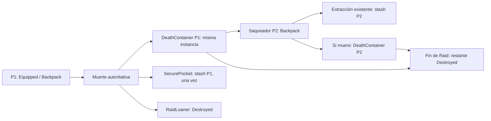

# Raid Death Loot Container Foundation

Base: `fa2456210fc720619a53106516b275119ba768f0`. Rama: `feat/raid-death-loot-container`. La representación del contenedor y el HUD son diagnósticos; no constituyen arte definitivo.

Ya existían `QusapRaidSession.SettleDeath`, el registro lógico `QusapDeathLootRecord`, el ledger `QusapLootWorld` y una vista creada por `QusapRaidBootstrap`. Este hito conecta esa misma vista y ese mismo registro a `QusapLocalWorldLootAuthority` y al bridge de interacción aprobado. No introduce otra autoridad de muerte, otro inventario ni otra copia del loot.

El settlement reserva backpack, equipo y bolsillo bajo el mismo Gate. Libera el arma nativa mediante el adaptador existente y conserva las instancias y las cantidades restantes. El bolsillo se devuelve una vez por la transacción existente del stash; la presentación nunca escribe al stash. RaidLoaner se retira inmediatamente y queda `Destroyed`, también si fue soltado por su último portador y aún sigue libre. Un préstamo adquirido por otro jugador pertenece a ese otro jugador y no se destruye al morir el primero.

El ID físico es `death/{RaidId escapado}/{PlayerId escapado}/{EliminationOrdinal}`. El ordinal positivo avanza únicamente tras un settlement confirmado. Se conserva el antiguo settlement key interno `{RaidId}/death/{PlayerId}` para los receipts y ActiveDeploymentManifest existentes. Repetir la eliminación devuelve el mismo registro sin duplicar vista, cargo, devolución o destrucción.

El origen de muerte usa `DeathContainer` y su holder original, sin mover sus instancias a `WorldContainer`. Abrir no crea recetas, tablas, rolls, armas ni IDs. Versiones, reservas, Full, StaleRequest y transferencia de unidad/stack usan la autoridad existente. La extracción de una unidad de un stack sigue la regla aprobada de partes deterministas; el origen conserva su ID y su cantidad restante. La validación persistente acepta esas partes, incluidas partes anidadas tras otra muerte, sin cambiar el DTO ni el allocator original.

`QusapDeathLootPresentation` enlaza la vista única ya creada. El resolver consulta solidez y suelo mediante máscaras configurables, conserva Z y registra EliminationPosition, GroundProjection o LastSafePosition. Nunca mueve el actor ni escribe en su Rigidbody/Collider. Si no existe una posición segura, mantiene el registro lógico y reintenta colocar la misma vista. El componente de última posición segura solo observa al actor activo.

La opción StartsOpened configura la autoridad; ambas opciones requieren el hold completo de 0,45 s para abrir la presentación. Se reutilizan rango, selección, histéresis, LOS, cancelaciones y transferencia aprobados. El host aislado retira sensor, bridge y prompts del eliminado después del settlement; usa la retirada nativa existente para impedir reequipo o reactivación. Al finalizar, el mismo ledger marca el cargo abandonado Destroyed y retira sus armas. Finalize repetido no incrementa contadores ni restaura instancias.

La escena `Assets/_Qusap/Scenes/RaidDeathLootContainerPlayground.unity` permanece fuera de Build Settings. Usa dos actores nativos y owners separados `memory/P1` y `memory/P2`. P1 lleva espada persistente, material x5, curación restante x1, reliquia protegida y préstamo. Otro consumible está completamente consumido. P2 lleva dos slots ocupados y consume su curación mediante la API existente para liberar uno. P1 se prepara con 1 HP mediante el daño de entorno existente para que un BodyAttack real de P2 complete la demostración; no se cambian daños, combate, movimiento ni tiempos. La zona de extracción mantiene la cuenta regresiva real de 5 s.

Bindings diagnósticos: P1 **F**, P2 **D-pad arriba**. **E** conserva WeaponSwapThrow. El bridge solo se instala en los dos playgrounds aislados. InputActions, InputReader, prefab principal, escenas de producción y Build Settings mantienen sus bytes.

Las pruebas permanentes nuevas cubren las 34 condiciones del pedido, más préstamos disarmados/adquiridos por un rival, partes deterministas, StartsOpened y APIs legacy que invalidan versiones. Se actualizan tres regresiones existentes por el segundo instalador diagnóstico y la nueva política explícita de destrucción de préstamos/cargo abandonado. Las pruebas afectadas iniciales pasaron: EditMode 244/244 y PlayMode 88/88. La validación final de suites completas sin filtros pasó: EditMode 618/618 y PlayMode 574/574, con cero fallos, omitidas e inconclusas. La Console no añade errores ni warnings al baseline aprobado.

La captura y todos los logs/XML/perfiles de prueba se conservan externamente en `C:/Dev/Qusap_ArtSource_Recovered/RaidDeathLootContainerFoundation`. Unity se ejecuta exclusivamente en la copia `C:/Dev/QDLC_20261011`; la escena definitiva se autoró allí y se copió con su meta. El grabador externo usa dispositivos nativos para ataque, movimiento y hold, botones del HUD para comandos y la extracción física existente. No lee el perfil real ni se incluye en los archivos definitivos.
