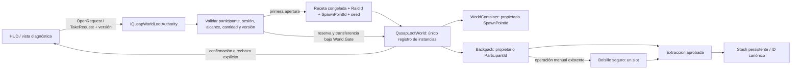

# Raid World Loot Containers Foundation

Escena aislada: `Assets/_Qusap/Scenes/RaidWorldLootPlayground.unity`. Permanece fuera de Build Settings. Los cubos, HUD y controles adicionales son diagnósticos provisionales; no modifican escenas de producción, prefabs, combate, movimiento, animaciones ni InputActions.

## Uso

La escena utiliza el deployment aprobado y un perfil temporal inyectado por el playground existente. Comienza con Basic Sword `RaidLoaner`, seis slots vacíos y bolsillo vacío. El stash inicial contiene las tres instancias de demostración del playground de deployment, no loot de los contenedores. La seed inicial es 606.

Moverse con los controles nativos hasta el contenedor; distancia máxima de interacción: 2,75 unidades desde el Rigidbody del participante.

| Control | Operación |
| --- | --- |
| 1 / 2 / 3 | Seleccionar CommonCache / MedicalCache / HighValueCache |
| O | Solicitar apertura |
| J / K / L | Seleccionar roll 0 / 1 / 2 |
| T / Y | Solicitar cantidad completa / una unidad al backpack |
| B | Mover manualmente la última instancia recibida al bolsillo mediante la operación existente |
| H | Consumir una curación del backpack mediante la operación existente |
| V | Aplicar 25 de daño mediante la API existente, exclusivamente para comprobar curación |
| Movimiento nativo | Entrar al volumen de extracción situado a la izquierda para usar el flujo aprobado |

Las solicitudes solo se permiten a participantes registrados, activos y próximos. Los rechazos muestran una razón explícita. El HUD conserva las identidades completas, cantidades, rarezas, estados, versiones, generación, contadores, slots, bolsillo y stash.

## Tablas provisionales configurables

Cada cache utiliza un `QusapWorldLootTable` con límites de rolls y un `QusapRaidLootTable` independiente con pesos/cantidades. La receta se congela al registrar el spawn: editar el asset durante la incursión no altera esa receta. Cada roll elige una fila por peso y después una cantidad inclusiva. Los límites de rolls son inclusivos. Todos los pesos de cada tabla suman 100; no hay garantía de reliquia.

| Tabla | Rolls | ID de entrada | ID canónico resultante | Peso | Cantidad | Rareza |
| --- | --- | --- | --- | ---: | --- | --- |
| CommonCache | 1–3 | raid_fragment | raid_fragment | 55 | 1–3 | Common |
| CommonCache | 1–3 | raid_ancient_scale | raid_ancient_scale | 25 | 1–2 | Uncommon |
| CommonCache | 1–3 | raid_minor_heal | raid_healing | 15 | 1–2 | Common |
| CommonCache | 1–3 | raid_basic_sword | raid_qusap_sword_blue | 3 | 1 | Common |
| CommonCache | 1–3 | raid_qusap_sword_white | raid_qusap_sword_white | 2 | 1 | Common |
| MedicalCache | 1–2 | raid_minor_heal | raid_healing | 80 | 1–2 | Common |
| MedicalCache | 1–2 | raid_major_heal | raid_major_heal | 10 | 1 | Rare |
| MedicalCache | 1–2 | raid_fragment | raid_fragment | 10 | 1–2 | Common |
| HighValueCache | 1–2 | raid_resonant_crystal | raid_resonant_crystal | 93 | 1–2 | Rare |
| HighValueCache | 1–2 | raid_purple_sword | raid_qusap_sword_purple | 6 | 1 | Rare |
| HighValueCache | 1–2 | raid_rare_relic | raid_rarerelic | 1 | 1 | Epic |

No se crean definiciones ni se cambia el catálogo aprobado: nueve canónicos y cinco aliases directos. Armas y reliquias siempre tienen cantidad uno; materiales y consumibles respetan MaxStack. Las tablas son no vacías y no generan RaidLoaner.

## Autoridad, identidad y propiedad

`IQusapWorldLootAuthority` separa solicitudes y recibos de la vista. La implementación local usa el mismo `World.Gate` que el inventario aprobado; no simula transporte ni networking. El contenedor guarda receta y estado, no una segunda colección propietaria de objetos. Sus snapshots se proyectan desde el registro único.

Cada SpawnPointId se registra una sola vez por mundo, incluso entre dos autoridades locales. `Unopened` no tiene instancias publicadas; la primera apertura publica un lote validado completo. Reabrir no genera. `Opened` conserva unidades; `Depleted` significa que ya no quedan unidades transferibles, y tampoco regenera.

La seed determinista utiliza SHA-256 sobre componentes UTF-8 con longitud y campos explícitos; el generador SplitMix64 existente tiene dominios separados para conteo y contenido. No utiliza DateTime, GetHashCode, Random global ni GUID aleatorio para resolver loot. El RaidId procede de la sesión existente.

Formato de identidad raíz: `Escape(RaidId)/world/Escape(SpawnPointId)/roll/índice`. El escape canónico hace inequívocos los separadores. Un cambio de RaidId produce IDs distintos aun con igual seed/spawn. Una transferencia completa conserva exactamente el objeto y su ID. Una división parcial conserva el ID original en el contenedor y asigna al fragmento `ID-original/part/ordinal`, únicamente tras confirmar la división. El apilado conserva el ID del stack receptor y las cantidades totales; una fuente agotada por fusión queda como tombstone `Merged` en memoria, sin propietario ni persistencia.

La transferencia planea primero los stacks compatibles y después un slot vacío. Confirma la cantidad solicitada completa o no modifica nada. Un backpack lleno puede aceptar unidades si caben en stacks compatibles. La versión cambia solo tras una transferencia confirmada; dos solicitudes con la misma versión confirman una y rechazan explícitamente la otra. Cancelar o no enviar una solicitud no cambia origen ni destino.

## Persistencia y compatibilidad

No se serializan contenedores ni instancias que permanezcan en ellos. Tomar, apilar y mover al bolsillo no incorporan loot nuevo al perfil. La extracción existente es la única entrada al stash. El préstamo continúa sujeto a sus reglas aprobadas: bolsillo/stash prohibidos, descarte final y ninguna escritura propia.

SchemaVersion permanece en 2 y el formato de objetos no añade campos. La validación admite los IDs deterministas de mundo y de fragmentos para que la extracción, recarga y posterior deployment conserven su identidad. Los IDs históricos `RaidId/loot/contador` y sus límites de asignación permanecen intactos; SchemaVersion 1 mantiene su validación histórica. No se renombra ni migra estéticamente ningún perfil. El ID serializado de definición siempre es canónico.

La ruta de producción existente permanece `Application.persistentDataPath/Qusap/profile-v1.json`. Las pruebas y el video utilizan exclusivamente directorios temporales o de evidencia inyectados. El checksum existente detecta corrupción; no es protección antitrampas.

## Validación y evidencia

Las pruebas nuevas cubren determinismo, identidades, aliases, límites, concurrencia real de dos actores, atomicidad, cancelación, capacidad, apilado y división, agotamiento, persistencia/extracción, recuperación de identidad para redeployment, bolsillo, sesión terminada, alcance, generación reentrante y referencias de escena. Se ejecutan únicamente las suites afectadas antes de la aprobación visual.

El video continuo automatiza las APIs reales en una copia aislada. El caso de backpack lleno añade cinco fixtures temporales de Major Heal, señalados en pantalla, y los consume antes de extraer: nunca llegan al stash. La seed de evidencia se busca antes de abrir usando las tablas normales para mostrar los casos pedidos; no modifica pesos ni garantiza reliquias. La extracción utiliza movimiento nativo hacia el volumen existente. Grabadores, generadores, perfiles, capturas y resultados permanecen fuera del proyecto fuente y no forman parte de los archivos definitivos.

La autoridad es local y reemplazable. No ofrece servidor, sincronización, antitrampas, tienda, economía ni UI final.
