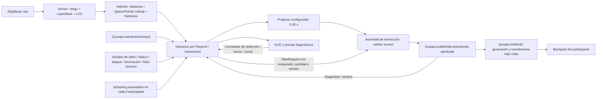

# Raid World Loot Physical Interaction Foundation

Escena aislada: `Assets/_Qusap/Scenes/RaidWorldLootInteractionPlayground.unity`, fuera de Build Settings. Dos jugadores con Rigidbody, lectores, motores y combate existentes; tres caches con tablas aprobadas y pared sólida. Componentes de interacción añadidos a las instancias únicamente al iniciar este playground. El prefab principal y las escenas anteriores permanecen intactos.

## Entrada auditada

`QusapControls.inputactions` contiene Move, Jump, Drop, Dash, WeakKick/BodyAttack, StrongKick/WeaponLight, Headbutt, WeaponStrong, WeaponSwapThrow y Parry. No contiene Interact ni Roll. Los jugadores utilizan `QusapInputReader`, que clona las acciones y restringe dispositivos/grupos; no necesitan `PlayerInput` de Unity para este flujo.

| Jugador del playground | Abrir/reabrir | Seleccionar | Tomar unidad / stack | Cerrar |
| --- | --- | --- | --- | --- |
| P1 | Mantener F | [ / ] o botones HUD | Y / T o botones HUD | C o HUD |
| P2 | Mantener D-pad arriba | Botones HUD < / > | Botones HUD | Botón HUD |

El bridge devuelve `QusapLootInteractionCommand` mediante `IQusapLootInteractionInput`. El interactor no conoce teclas ni ranuras P1/P2; acepta PlayerId e InteractorId arbitrarios. Los botones del HUD encolan los mismos comandos. No se reutilizan salto, BodyAttack, LightWeapon, HeavyWeapon, Headbutt, Parry ni Dash para saqueo.

**Corrección del binding diagnóstico:** P1 mantiene F, libre en las acciones Gameplay resueltas de su lector. E conserva exclusivamente WeaponSwapThrow y ya no inicia Interact. P2 conserva D-pad arriba, sin otra acción de Gameplay resuelta para ese control; la captura vertical de WeaponSwapThrow solo se consulta al pulsar su rightTrigger. Se verifican los eventos de acciones y la identidad del arma durante hold, cancelación, apertura, transferencia e impacto real. No se deshabilita, consume ni modifica ninguna acción nativa. Antes de producción debe decidirse una acción Interact dedicada y su binding definitivo por dispositivo. Los botones de saqueo de P2 son provisionales de mouse; no se asignan hombros ni botones de ataque del gamepad.

## Separación

El HUD solo presenta snapshots y encola comandos. El interactor no accede a stash, perfiles ni bolsillo seguro. La autoridad adicional valida acceso físico y Running y delega íntegramente generación y transferencia a las operaciones existentes.

## Selección y cancelación

Rango inicial 2,75; histéresis 0,20; duración inicial 0,45 segundos; configurables en el root de la escena. Se elige menor distancia física y, en igualdad exacta, SpawnPointId ordinal. Solo el objetivo anterior admite la franja adicional de histéresis para conservar el prompt; **abrir y tomar siempre exigen el rango estricto**. Un candidato más cercano válido puede sustituirlo.

La LOS usa LayerMask de sólidos configurable, ignora triggers, el propio jugador, otros jugadores y la vista objetivo. Detecta además un sólido que contiene el origen del raycast. Las one-way consultan su SolidCollider y la configuración actual IgnoreCollision por jugador; no bloquean cuando permiten paso físico.

Soltar, alejarse, perder LOS, cambiar/perder/destruir el objetivo, daño, hitstun, eliminación, dash, ataque o fin de Running cancelan. Daño, hitstun, eliminación, ataque y fin de sesión usan sus eventos autoritativos. Dash no tiene evento de inicio: se lee IsDashing después del motor en cada paso físico. No se crean relojes de combate. Moverse dentro del rango manteniendo objetivo y LOS permite completar el hold. Una cancelación exige soltar antes de otro intento; no reintenta automáticamente mientras se mantiene el botón.

Depleted puede mostrar Vacío, pero no inicia hold. Reabrir un contenedor abierto solicita la operación aprobada y muestra el estado actual. Cerrar o alejarse descarta solo la presentación. No utiliza animaciones nuevas, Animation Events, Has Exit Time, Root Motion ni cambios de timeScale.

## Transferencias y competencia

Cada observador conserva un snapshot con versión e identidad seleccionada. La selección se conserva por InstanceId mientras siga existiendo. El coordinador prepara todos los comandos de un frame antes de enviar las transferencias: dos jugadores que solicitan la misma unidad desde la misma versión envían solicitudes comparables. Se confirma una; la segunda muestra Solicitud obsoleta (StaleRequest). Después ambos observan el estado actual del único ledger. No hay reservas al seleccionar ni espacio consumido por rechazos.

La versión aprobada es **por contenedor**, no por objeto. Solicitudes a objetos distintos se confirman independientemente cuando cada una usa la versión vigente; si se construyen contra la misma versión antigua, la segunda también es StaleRequest, incluso para otro objeto. Debe refrescarse y enviarse una nueva solicitud explícita. No se introduce un reintento oculto ni se cambia la semántica aprobada.

Tomar una unidad utiliza cantidad 1; tomar stack utiliza la cantidad del snapshot. La autoridad confirma toda la cantidad o conserva el origen si no cabe. Las divisiones y fusiones mantienen las reglas de identidad existentes. Ningún flujo lleva loot automáticamente al bolsillo.

## Aislamiento y validación

La escena utiliza `QusapRaidBootstrap` + `QusapRaidSessionObserver` y el catálogo existente, con una sesión/stash **en memoria**. No incluye persistencia, deployment ni extracción, y no escribe el perfil real. El movimiento y los ataques permanecen activos para ambos jugadores durante el hold.

Las pruebas permanentes incluyen `QusapLootInteractionEditModeTests`, `QusapLootInteractionPlayModeTests` y ambas suites `QusapLootBindingCorrection*Tests`, junto con las suites existentes. Tras la aprobación visual se ejecutaron las suites completas sin filtros: EditMode 595/595 y PlayMode 558/558; cero fallos, omitidas o inconclusas. Se ejecutaron en una copia de validación, con directorios de perfil de prueba explícitos y aislados. Las pruebas de integración colocan fixtures físicos para aislar condiciones; los videos aprobados usan movimiento, salto e impacto reales mediante dispositivos de entrada, sin teletransportar jugadores.

Los resultados, Console completa, videos, eventos por frame, auditoría de preservación, listas exactas de archivos y estado Git se conservan fuera del commit en `C:/Dev/Qusap_ArtSource_Recovered/RaidWorldLootPhysicalInteractionFoundation`. La corrección F añade regresiones de binding y equipo, con evidencia en `BindingCorrection_F`; conserva la evidencia aprobada anterior. La auditoría final y los resultados completos están en `Finalization_20261011`. Se conservan la escena, el HUD y el bridge diagnósticos como herramientas deliberadas de esta foundation; el constructor de escena de un solo uso, las capturas, logs, XML, perfiles y demás temporales se excluyen. El bridge se instala únicamente desde esta escena aislada, que permanece fuera de Build Settings.
